# SageV-Batch

SageV-Batch simulates a pipelined RV32I processor cycle by cycle on an AMD GPU, many programs at a time. It is Lance Xavier Lim's integrating project for Advanced Computer Architecture, 1st Term SY 2026-2027, De La Salle University.

SageV is a web simulator of a five-stage RV32I pipeline, and its core runs one program at a time. SageV-Batch runs thousands of unrelated programs at once through HIP on an AMD Radeon RX 6600 XT, giving each simulated machine its own GPU thread. SageV's own TypeScript core checks every result, and the timings are compared with a sequential C++ version of the same step function.

This README has three parts, newest first: the final report (Week 13), the mid-project milestone (Week 10) and the proposal (Week 6).

- Final video: (link to be added)
- Week 10 milestone report: [MILESTONE-2.md](MILESTONE-2.md)
- Proposal: [SageV-Batch_Project_Proposal_3.pdf](SageV-Batch_Project_Proposal_3.pdf)
- Week 6 video pitch: [video pitch.mp4](video%20pitch.mp4)

---
---

## Final report (Week 13)

### Summary

The proposal promised, for Week 13, a GPU kernel for the full five-stage pipeline that matches SageV exactly, and a timing comparison against the sequential version across batch sizes. Both are done.

The five-stage pipeline (SageV's Pipeline 2) now runs on the RX 6600 XT, one thread per simulated machine. On 65,536 random programs its results match SageV's on every register, every memory byte, the PC, the cycle count, instructions retired, stall cycles, flushes and the halt status, and they are byte for byte the same as the sequential C++ engine's. Every GPU result also passed its check at every batch size from 1,024 to 4,194,304 programs.

From 8,192 programs up, the simulation kernel runs 48 to 110 times as fast as one CPU thread. End to end, counting every copy between the host and the GPU, the GPU is 3.3 to 4.8 times as fast when it returns full results, and 4.4 to 8.0 times as fast when it returns only the pass/fail flags that verification needs. With pinned memory and four streams, 4,194,304 programs take 748 ms end to end against 4,423 ms on the CPU, which is 5.9 times as fast.

The other Week 13 tasks were measured too: the cost of threads that finish early and grouping programs by length, keeping memory in the local data share (LDS) against global memory, and pinned memory with overlapped copies. Not every one of them helped; the details are under [Results](#results) and [What is not working](#what-is-not-working).

### Source code

All the code is in this repository. SageV is included as a git submodule, `sagev/`, pinned to the commit the engines were checked against.

| Path | Contents |
| --- | --- |
| `sagev/` | SageV, as a git submodule |
| `tools/export.ts` | Makes random programs with SageV's generator, assembles them with SageV's assembler, runs them on SageV's core, and writes the batch file and the expected results |
| `tools/edges.ts` | Writes a small edge batch: one program that stores to each of the 64 memory words, and three stores that wrap past address 0xFF |
| `tools/check.ts` | Compares each engine result with SageV's expected result, field by field, then re-runs a random sample on SageV's core |
| `tools/flagtest.ts` | Changes one field in each of several expected results (8 for the non-pipelined model, 10 for the pipeline) and checks that exactly those programs fail |
| `engine/rv32.h`, `engine/machine.h` | The decoder, ALU, branch comparator and memory access that every model uses |
| `engine/p2.h` | The five-stage pipeline (SageV's Pipeline 2), with forwarding, load-use and branch stalls, branches resolved in ID, and flushes |
| `engine/p0.h` | The non-pipelined model (SageV's Pipeline 0) |
| `engine/soa.h` | What each GPU thread does: it spreads its program record into the structure of arrays, runs the program, checks the result and writes it back. The same code runs on the CPU (`--engine soa`) to test the kernel code |
| `engine/hip/gpu.hip` | The HIP host code: device selection, buffers, streams, copies and kernel launches, plus the LDS kernel |
| `engine/hip/hello.hip` | A one-kernel test that the RX 6600 XT is found and selected |
| `engine/main.cpp` | The command line, with `run` and `bench` |
| `experiments.ps1` | Runs every timing experiment in this report |
| `tools/charts.py`, `tools/tables.py` | Draw the charts and write the tables from the raw timing files |
| `results/` | Charts, [tables.md](results/tables.md) and the raw CSV files in `results/raw/`, with a second full run in `results/raw-repeat/`. The Week 10 timings are in [p0_timing.md](results/p0_timing.md) |

#### Running it

You need Node.js 20 or later, Visual Studio 2022 Build Tools with the C++ workload, and AMD HIP SDK 6.2.4 for Windows. HIP 6.2's compiler cannot read the headers of Visual Studio versions after 2022, so `build.ps1` uses the 2022 tools even when a newer Visual Studio is installed.

```
git clone --recurse-submodules https://github.com/JohnathanTantanan/integrating-project.git
cd integrating-project
npm install
npx tsx tools/export.ts --count 65536 --out data
npx tsx tools/edges.ts
powershell -File build.ps1
build\hello.exe
```

Sequential mode (one CPU thread) and parallel mode (the GPU) use the same command with a different `--engine`:

```
build\sagev-batch.exe run --model p2 --engine cpu --batch data\batch.bin --expected data\expected_p2.bin --out data\result_p2_cpu.bin
build\sagev-batch.exe run --model p2 --engine hip --batch data\batch.bin --expected data\expected_p2.bin --out data\result_p2_hip.bin
npx tsx tools/check.ts --model p2 --batch data\batch.bin --expected data\expected_p2.bin --results data\result_p2_hip.bin
npx tsx tools/flagtest.ts --model p2
powershell -File experiments.ps1
python tools/charts.py
python tools/tables.py
```

`--model p0` runs the non-pipelined model. The GPU options are `--order none|count|cycles` (grouping by length), `--lds 1`, `--pinned 1`, `--streams K` and `--block B`. The same `--seed` (default 20261109) always gives the same programs.

### Screenshots

Building, and the program finding the RX 6600 XT:

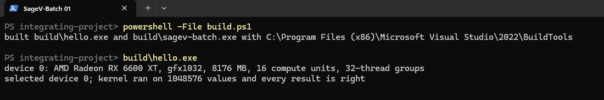

The input, 65,536 random programs exported from SageV:

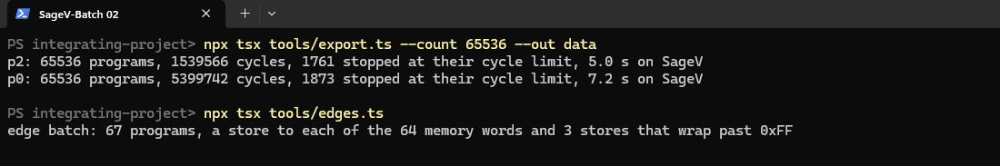

Sequential mode, the five-stage pipeline on one CPU thread, and its check against SageV:

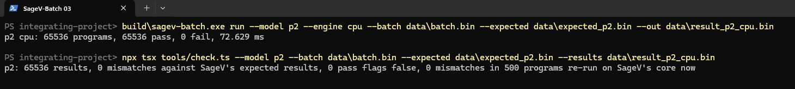

Parallel mode, the same batch on the GPU, its check against SageV and the comparison with the sequential results:

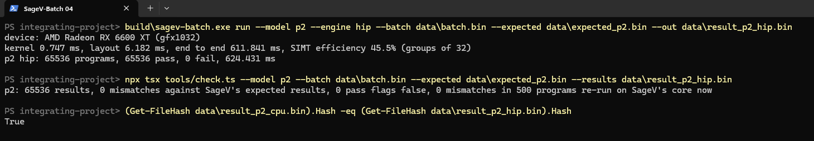

The flag test, with ten corrupted expected results:

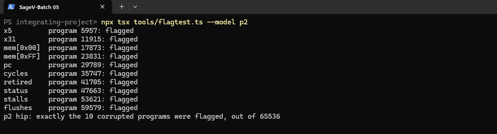

The timing sweep:

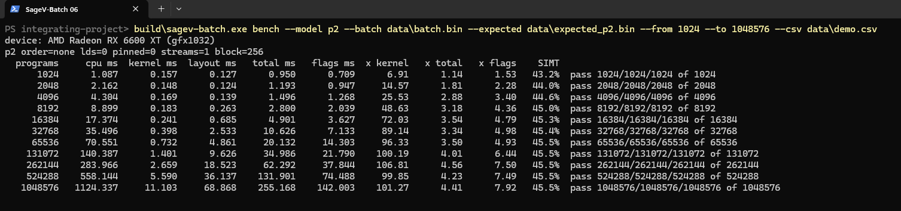

### Input, process and output

**Input.** A batch file of programs. Each record holds a program's 256-byte memory image (data at 0x00 to 0x7F, up to 32 instructions at 0x80 to 0xFF), its 32 starting registers, its instruction count and a cycle limit, 392 bytes in all. `tools/export.ts` makes the programs with SageV's own random generator and assembler. A quarter of them get random bytes in every memory byte they do not use, and about 3% get a cycle limit shorter than their run, so the engines are also tested on machines stopped part way through.

**Process.** Each simulated machine gets one GPU thread. The thread copies its record into the structure of arrays, then runs the machine one cycle at a time until it halts or reaches its cycle limit. Each cycle does what SageV's core does, in the same order: write-back, memory, execute with forwarding, decode with the hazard checks and branch resolution, then fetch. At the end, the thread compares its final state with the expected state and sets a pass flag.

**Output.** For each program: the 32 registers, all 256 bytes of memory, the PC, the cycle count, instructions retired, stall cycles, flushes, the halt status (halted, or stopped at the cycle limit) and the pass flag, 412 bytes in all. The host can ask for only the pass flags, which is all a verification run needs. `bench` also writes a timing table for each batch size.

### Design methodology

**Port first, parallelize second.** The work was split so that a mistake in porting SageV to C++ would show up apart from a mistake in moving the work to the GPU. Week 10 delivered the sequential C++ engine and a GPU kernel for the simpler non-pipelined model. Week 13 put the five-stage pipeline on the GPU.

**One step function for both sides.** `engine/p2.h` and `engine/p0.h` are written once. Every function is marked to compile for both the host and the GPU, and each is a template over the memory type. The sequential baseline gives it a plain array; a GPU thread gives it a view into the structure of arrays. So the sequential and parallel versions run the same algorithm, and any difference in time comes from running it in parallel.

**Data layout.** The architectural state is a structure of arrays: register r of thread t is at `regs[r * N + t]`, and memory is 64 words per machine at `mem[w * N + t]`. When neighbouring threads read the same register, they read neighbouring words. The host copies each program record as it is, and a first GPU kernel spreads it into the arrays. A last kernel compares the result with the expected state and gathers it back into records.

**Pipeline registers stay in the thread.** The proposal planned to store the pipeline registers as arrays too. They are read and written every cycle, so the kernel keeps them in each thread's own registers instead. The compiled pipeline kernel uses 44 vector registers per thread and spills nothing to memory.

**Branching.** The proposal planned to rewrite the step by hand into a branch-free, predicated form. The kernel instead runs the same branching C++ step, and the compiled code shows what the GPU does with it: 131 conditional branches, 130 of which are "skip this block if no thread in the group needs it". A thread group runs each path that any of its threads needs, one after another, with the threads that do not need it masked off. That is the same masking the hand-written version would do, except that a block no thread needs is skipped. The hand-written version was not built; see [What is not working](#what-is-not-working).

**Device selection.** The Ryzen 5 5600G has an integrated GPU, so the host picks the device whose architecture is gfx1032 (the RX 6600 XT) instead of the default device.

**Host side.** GPU buffers, pinned host buffers, streams and events are created once and reused, as a long-running host would. When a bigger batch needs larger buffers, the whole set is freed and allocated again, which keeps GPU memory from fragmenting. With `--streams K` the batch is split into K chunks, and the copy of one chunk overlaps the kernels of the one before.

### Testing methodology

**Three versions that must agree.** SageV's TypeScript core produces the expected results. The sequential C++ engine must match them on every field of every program, and the GPU must match both, byte for byte. `tools/check.ts` compares every field, then runs a random sample of 500 programs through SageV's core again, so the check does not rest only on the saved file.

**Test data.** The main batch is 65,536 random programs from SageV's generator, with the random unused memory and short cycle limits described above. The edge batch from `tools/edges.ts` adds a store to each of the 64 memory words and three stores that wrap past 0xFF, because no random program happened to store to the last word.

**Every configuration, five times.** The default GPU run, LDS, pinned memory with one and several streams, both orderings, and a combination of all of them were each run five times on both models and both batches, 160 runs in all. Every result file was byte for byte the same as the C++ engine's, so the GPU results do not change from run to run. `bench` also checks every pass flag at every batch size.

**The checks catch mistakes.** A check that always passes proves nothing, so faults were planted on purpose, one at a time, and the checks had to fail.

- In Week 10, 22 faults in the C++ engine (forwarding priority swapped, a missing load-use stall, a branch that waits too little, no re-read during a stall, a memory read that does not wrap, an unsigned SLT and others) and 11 in the GPU code were all caught.
- In Week 13, 15 faults in the new GPU code were all caught: a stall or flush count not compared or copied from the wrong field, the wrong byte lane in memory, the pipeline kernel running the non-pipelined model, a skipped register, wrong chunk offsets, a missing wait after a copy, and an LDS kernel that writes back only 63 of its 64 words. The 63-word fault first went unnoticed, which is why the edge batch exists.
- `tools/flagtest.ts` corrupts one field in each of ten expected results for the pipeline (two registers, the first and last memory byte, the PC, the cycle count, instructions retired, the status, stalls and flushes). The GPU flags exactly those ten programs out of 65,536.

**Timing.** Kernel time comes from HIP events and end-to-end time from the host clock, from the first copy to having the results in host memory. Each time is the best of three runs after one warm-up run, and both versions are built by the same compiler with `-O2`. The 65,536 programs are repeated to fill the larger batches. The whole set of experiments was run a second time after a restart, and that run is kept in `results/raw-repeat/`: 373 of the 404 timings were within 5% of the first run and 402 within 20%. The larger differences were in batches that take under a few milliseconds and in the CPU baseline itself, which varied by up to 11% on the large batches.

### Results

The full tables are in [results/tables.md](results/tables.md), written from the raw files in `results/raw/`.

#### Sequential against parallel

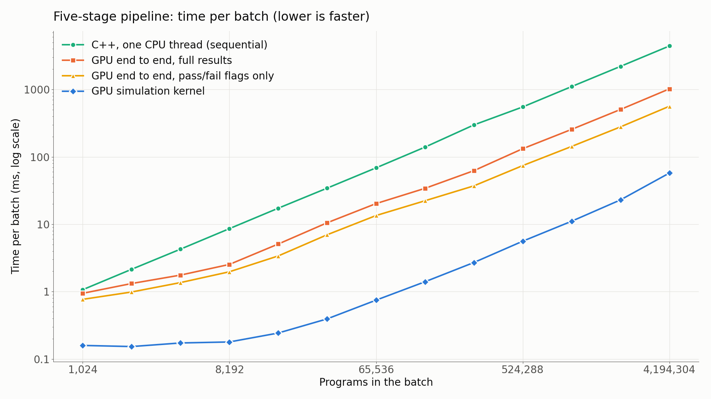

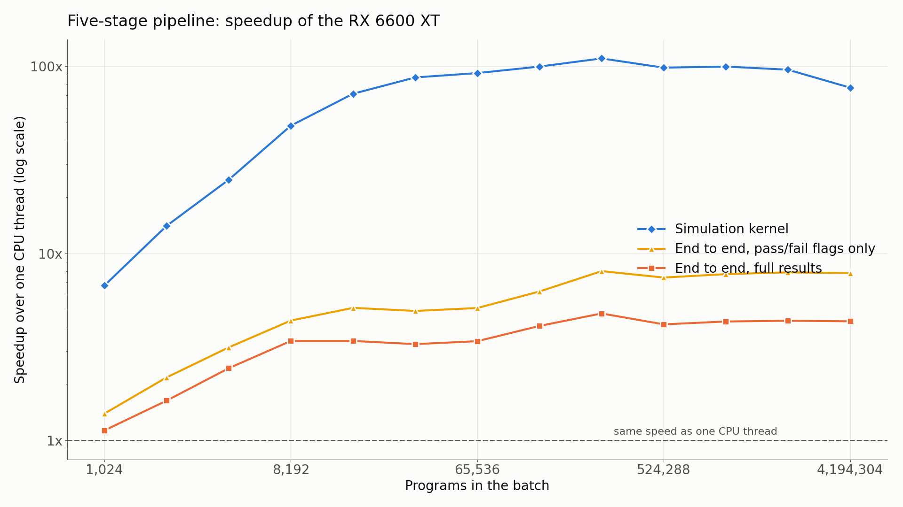

Five-stage pipeline, selected rows:

| Programs | C++ (ms) | Kernel (ms) | End to end, full (ms) | End to end, flags (ms) | Kernel speedup | Speedup, full | Speedup, flags |
| ---: | ---: | ---: | ---: | ---: | ---: | ---: | ---: |
| 1,024 | 1.068 | 0.159 | 0.944 | 0.768 | 6.73 | 1.13 | 1.39 |
| 8,192 | 8.600 | 0.179 | 2.533 | 1.970 | 48.13 | 3.40 | 4.37 |
| 65,536 | 68.718 | 0.747 | 20.260 | 13.462 | 91.95 | 3.39 | 5.10 |
| 262,144 | 297.692 | 2.703 | 62.368 | 37.093 | 110.14 | 4.77 | 8.03 |
| 1,048,576 | 1,104.414 | 11.085 | 255.827 | 142.750 | 99.63 | 4.32 | 7.74 |
| 4,194,304 | 4,422.726 | 57.548 | 1,020.984 | 564.100 | 76.85 | 4.33 | 7.84 |

Non-pipelined model, selected rows:

| Programs | C++ (ms) | Kernel (ms) | End to end, full (ms) | End to end, flags (ms) | Kernel speedup | Speedup, full | Speedup, flags |
| ---: | ---: | ---: | ---: | ---: | ---: | ---: | ---: |
| 1,024 | 0.323 | 0.072 | 0.955 | 0.732 | 4.49 | 0.34 | 0.44 |
| 8,192 | 2.563 | 0.083 | 2.459 | 1.853 | 30.80 | 1.04 | 1.38 |
| 65,536 | 20.637 | 0.519 | 20.037 | 13.370 | 39.77 | 1.03 | 1.54 |
| 262,144 | 83.396 | 2.207 | 62.346 | 37.561 | 37.78 | 1.34 | 2.22 |
| 1,048,576 | 374.135 | 10.045 | 255.262 | 141.053 | 37.25 | 1.47 | 2.65 |
| 4,194,304 | 1,321.475 | 53.000 | 1,015.851 | 561.600 | 24.93 | 1.30 | 2.35 |

The two models move the same data, 392 bytes in and 412 bytes out per program, but the pipeline does much more work per program. At 1,048,576 programs the C++ pipeline takes about three times as long as the C++ non-pipelined model (1,104 ms against 374 ms), while the two GPU kernels take nearly the same time (11.1 ms against 10.0 ms). That is why the pipeline gains so much more end to end. For both models, most of the end-to-end time is copying and conversion: at 1,048,576 programs the pipeline's kernel is 11 ms of its 256 ms.

The biggest batch is 4,194,304 programs. Each program needs about 1.2 KB of GPU memory, so the next size, 8,388,608, would need about 10 GB, more than the card's 8 GB.

#### Threads that finish early, and grouping by length

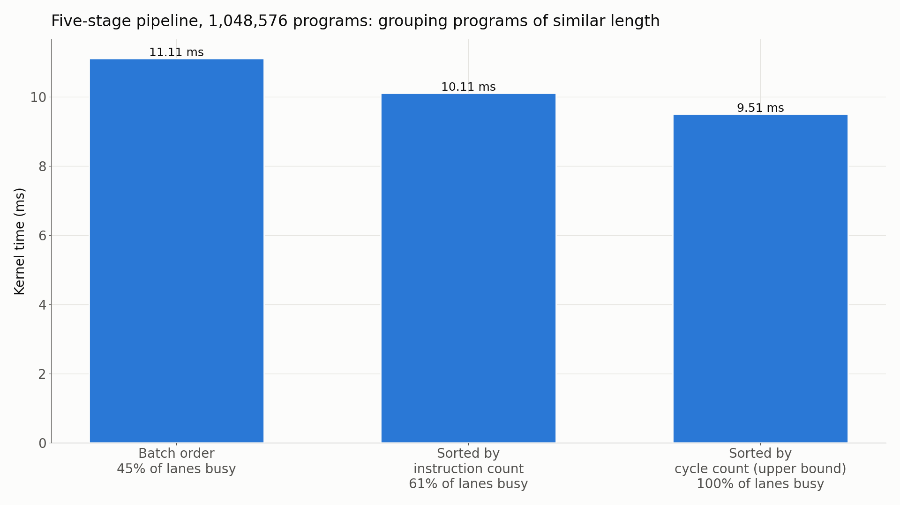

A thread group keeps running until its slowest thread halts, so threads that finish early sit idle. In batch order, only 45.5% of the thread slots in the pipeline kernel are doing work, on average. Sorting the batch by instruction count, which is known before the run, raises that to 60.8% and cuts the kernel time at 1,048,576 programs from 11.11 ms to 10.11 ms, 9% less. Sorting by the actual cycle count, which a real run would not know in advance, fills 100% of the slots but only cuts the time to 9.51 ms, 14% less. So idle threads are a real cost, but not the main one.

#### LDS against global memory

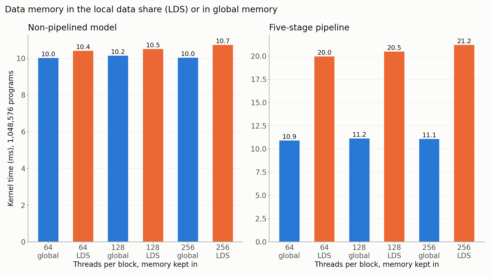

Keeping each machine's 256 bytes of memory in the LDS made both kernels slower at every block size tried. At 1,048,576 programs the non-pipelined kernel took 4% to 7% longer and the pipeline kernel 83% to 91% longer. The compiled code explains the pipeline's case. Indexing memory in the LDS needs more registers, and the LDS pipeline kernel uses all 128 vector registers and spills to scratch memory (117 loads and 113 stores in its code), while the global-memory version uses 44 and spills nothing. The programs touch memory only on loads, stores and fetches, so there was little to gain from faster memory in the first place.

#### Moving data

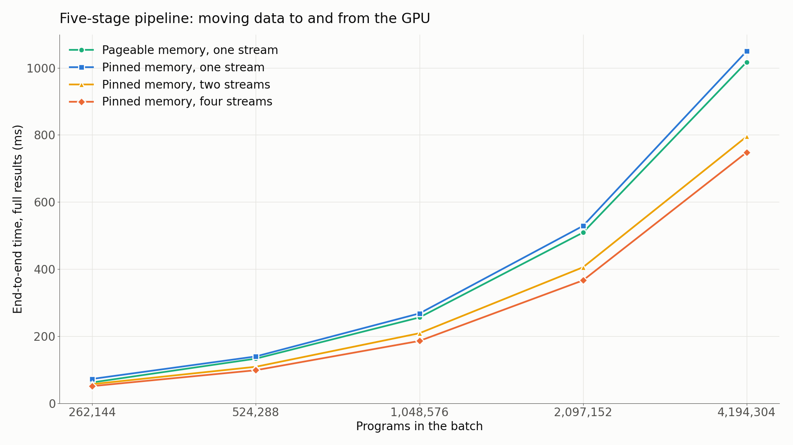

Pinned host memory alone was slightly slower than ordinary memory, because the program records first have to be copied into the pinned buffer. Splitting the batch over several streams, so that copies overlap the simulation, helped: with four streams, 4,194,304 programs take 748 ms end to end against 1,017 ms, 26% less, and 445 ms against 566 ms with flags only.

### AHA moments

**The GPU's pass flags caught bugs in the host code, not just in the simulator.** In the first version that used its own GPU streams, only 5,023 of 65,536 pipeline results passed. Copies from ordinary (pageable) memory on that stream were not ordered with the kernels that followed, so the kernels read input that had not arrived. Later, with pinned memory and several streams, HIP 6.2 on Windows sometimes started a stream's kernels before that stream's input copy had finished. Both were found only because every thread checks its own result. The host now waits for each chunk's input copy, which still lets it overlap the previous chunk's kernels.

**Allocation, not simulation, was the hidden cost.** Allocating and freeing GPU memory on every call made end-to-end time jump threefold between 8,192 and 16,384 programs. Keeping the buffers between calls raised the pipeline's end-to-end speedup at 1,048,576 programs from about 3.6 to 4.3. Growing those buffers one at a time then fragmented GPU memory, and 4,194,304 programs took 3.6 seconds instead of 1.0, until the code freed everything before growing.

**Faster memory made the kernel slower.** LDS is meant to be faster than global memory, but the extra indexing pushed the pipeline kernel past its register budget, and the spills cost far more than the LDS saved.

**Filling every thread slot bought only 14%.** Sorting by cycle count took the busy share from 45% to 100%, yet the kernel got only 14% faster. The cost that remains is in the work each cycle does and in memory traffic, not in idle threads.

**The same data, very different gains.** Both models move exactly the same bytes, but at 1,048,576 programs the pipeline is 4.3 times as fast end to end and the non-pipelined model only 1.5 times. A GPU pays off when there is enough work for each byte copied.

**Planting faults can take down the GPU.** Some planted faults, such as removing the wait after a copy, made the GPU driver stop responding, and Windows reset it. After a reset, every GPU program on this machine failed until the PC was restarted. The RX 6600 XT also drives the display, so fault testing on it had to be kept short and watched, and every result was checked again after a restart: 160 runs of every configuration were byte for byte the same as the C++ engine's, with no resets.

**From Week 10.** Converting the records into arrays on the host made the GPU ten times slower than the CPU until the conversion moved to the GPU. A planted fault that left one memory word unchecked survived until unused memory got random bytes. The default HIP device can be the 5600G's integrated GPU. And HIP 6.2's compiler cannot read the headers of newer Visual Studio versions.

### What is not working

- **The hand-written predicated step was not built.** The kernel runs SageV's branching step as compiled, and the GPU masks the threads that take each path. A version written as true/false masks and selects, as the proposal described, could be compared against it but was not written.
- **End-to-end time is still mostly data movement.** For the pipeline at 1,048,576 programs, the kernel takes 11 ms, the two conversion kernels 70 ms, and the copies most of the rest of the 256 ms.
- **Kernel times cannot be read with several streams.** With two or more streams, HIP's events report kernel times close to zero on this system, so those runs report end-to-end time only.
- **The LDS version is slower** and is kept only as an option.
- **Grouping by length needs a sort key.** Sorting by instruction count gave 9%. The 14% from sorting by cycle count needs the cycle counts, which are only known after a run.
- **Batch size stops at 4,194,304 programs**, because the next size would not fit in the card's 8 GB.
- **HIP has not yet been confirmed with the instructor** as acceptable for the "GPU/CUDA (SIMT)" option. HIP is AMD's counterpart to CUDA, with the same programming model.

### Video

(link to be added)

---
---

## Mid-project milestone (Week 10)

The full report is in [MILESTONE-2.md](MILESTONE-2.md).

The milestone was stated in the Week 6 video pitch: a sequential C++ batch engine that matches SageV exactly, and a HIP kernel for a simpler, non-pipelined RV32I model that matches the C++ engine, with first timings. The split was chosen so that errors in porting SageV to C++ show up apart from errors in moving the work to the GPU.

| Planned for Week 10 | Status | Evidence |
| --- | --- | --- |
| A sequential C++ batch engine that matches SageV exactly | Done | `engine/p2.h` matched SageV on 65,536 random programs (1,539,566 simulated cycles, 126,568 stall cycles, 87,887 flushes) on every field |
| A HIP kernel for the non-pipelined model that matches the C++ engine | Done | `engine/p0.h` on the RX 6600 XT gave results byte for byte the same as the C++ engine's, and both matched SageV |
| First timings | Done | [results/p0_timing.md](results/p0_timing.md), 1,024 to 4,194,304 programs |

At that milestone, the non-pipelined kernel was 26 to 48 times as fast as one CPU thread from 8,192 programs up, but only 1.04 to 1.09 times as fast end to end with full results, and 1.9 to 2.0 times with flags only. The report also listed the changes from the proposal (the conversion into arrays moved from the host to the GPU, and memory is stored as 64 words) and the Week 13 tasks, which the final report above covers.

---
---

## Proposal (Week 6)

The proposal is [SageV-Batch_Project_Proposal_3.pdf](SageV-Batch_Project_Proposal_3.pdf), and the pitch is [video pitch.mp4](video%20pitch.mp4).

**Abstract.** SageV is a web-based, cycle-accurate simulator of a five-stage pipelined RV32I processor and the foundation of an intelligent tutoring system for computer architecture. Its core runs one program at a time, which is enough for a student stepping through a pipeline. The planned tutoring features need far more. Randomized testing checks the simulator against a reference model over large sets of generated programs, and every generated practice exercise must be run to confirm that it produces the hazard it is meant to teach. SageV-Batch is a data-parallel engine that simulates thousands of RV32I programs at once on an AMD GPU through HIP, with one GPU thread for each simulated machine. Results are checked against SageV's existing TypeScript core, and execution time is compared with a sequential C++ version across increasing batch sizes.

**Inputs.** A batch of programs, each with its text image from SageV's assembler, its starting data and registers, and a cycle limit so that a program that loops forever still stops.

**Process.** The cycle step runs in parallel, one GPU thread per simulated machine, until each machine halts or reaches its cycle limit. Each thread then compares its final state with the expected one. Program generation, assembly and the analysis of results stay on the host, and the batch engine keeps only final states, not SageV's per-cycle history.

**Outputs.** For each program, the final registers and memory, the cycle, instruction, stall and flush counts, the halt status and a pass flag. For the batch, a mismatch report and a timing table comparing the sequential and GPU versions.

**Platform.** AMD Radeon RX 6600 XT (8 GB, gfx1032) with HIP SDK 6.2.4 for Windows, and an AMD Ryzen 5 5600G as the host and the sequential baseline.

| Week | Planned |
| --- | --- |
| 6 | Proposal and video pitch |
| 10 | Mid-project demo: the sequential C++ engine that matches SageV, and a HIP kernel for the non-pipelined model, with first timings |
| 13 | The five-stage pipeline kernel that matches SageV exactly, the timing comparison across batch sizes, and this repository with the code and the write-up |
